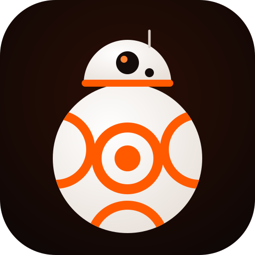

# Marca de BB-8

| Archivo | Para qué |
| --- | --- |
| [`logo.svg`](logo.svg) | Original, se escala a cualquier tamaño |
| [`logo-120.png`](logo-120.png) | Logo de la app en Google Cloud (*Branding*: 120 × 120) |
| [`logo-512.png`](logo-512.png) | Íconos, redes, presentaciones |

**Colores:** naranja `#ff5a00`, naranja claro `#ff8533`, blanco hueso `#f5efe9`, fondo `#0d0706` → `#2b0e04`.

## Nombre y frases

- **Nombre:** BB-8
- **Eslogan:** Tu robot de casa, rodando y escuchando.
- **Otras opciones:** «Pregúntale, pídele, rueda contigo.» · «El asistente que sí se mueve.»

## Descripción corta (una línea)

Robot esférico de casa que escucha, habla y te ayuda con tu agenda y tu hogar.

## Descripción larga

BB-8 es un robot esférico hecho en casa. Lo llamas con «Oye BB-8» y te reconoce por la voz:
te dice qué tienes hoy en tu calendario, te avisa cuando alguien te agenda algo, prende las
luces, busca en internet y rueda hasta donde le pidas. Tus cuentas se quedan contigo: cada
persona entra con la suya, y BB-8 pregunta antes de enviar, crear o borrar algo.

## Google Cloud → Branding

| Campo | Texto |
| --- | --- |
| App name | BB-8 |
| User support email | tu correo |
| App logo | `logo-120.png` (ver nota) |
| Application home page | https://bb8.zerock.name/acerca |
| Privacy policy | https://bb8.zerock.name/privacidad |
| Terms of service | https://bb8.zerock.name/terminos |
| Authorized domains | `zerock.name`, `erickdsama.github.io` |
| Developer contact | tu correo |

**Nota:** subir un logo hace que Google pida *verificar la marca* (revisión de días o
semanas) antes de mostrarlo. Para uso de la casa no hace falta: déjalo vacío y la pantalla
de Google muestra solo «BB-8».

## Textos de la pantalla de entrada (bb8-web)

- **Título:** BB-8
- **Subtítulo:** Entra para hablar con tu robot.
- **Botón:** Entrar
- **Error:** Contraseña incorrecta.
- **Robot apagado:** BB-8 está apagado. Se conecta solo cuando lo enciendes.

## Mensajes al conectar servicios

- **Google:** Entra con tu cuenta de Google y BB-8 podrá leer tu calendario y agendar por ti.
- **Google Home:** BB-8 podrá ver y controlar las luces, enchufes y termostatos de tu casa.
- **Listo:** ¡Conectado! Ya puedes pedirle a BB-8 lo que necesites.

*BB-8 es una marca de Lucasfilm. Este es un proyecto personal sin fines de lucro; no usar el
logo con fines comerciales.*
