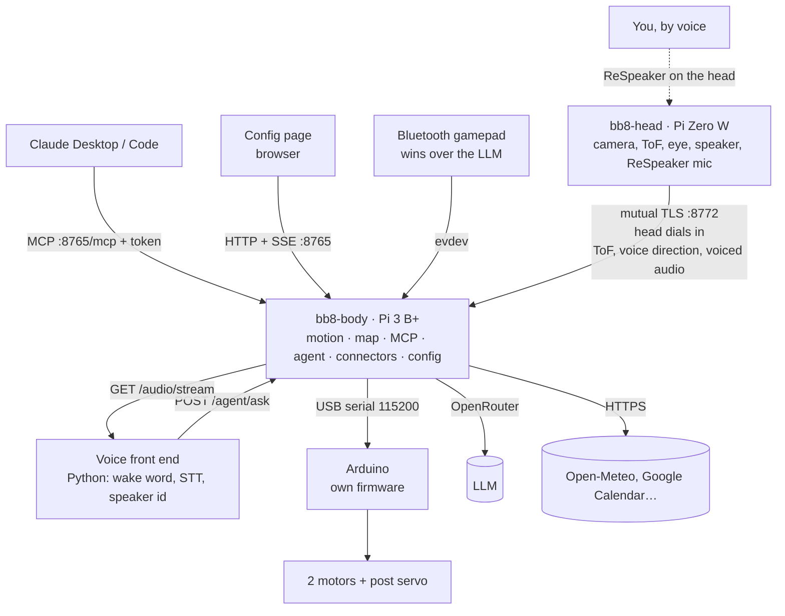

# Architecture

BB-8 works like a Sphero. A two-wheel base rolls inside the sphere and turns it. Ballast at the bottom keeps it upright, and a post with magnets holds the head through the shell.

The software has three layers, each slower and smarter than the one below. It has two Go binaries and no ROS.



## A voice order, end to end

This is the path at run time. **Claude is not in it**: the brain is the OpenRouter agent inside `bb8-body`.

```
voice ─► ReSpeaker (head, Zero W) ──► mutual TLS ──► bb8-body (Pi 3)
          VAD + direction                              │
                                                       ├─► voz: wake word + STT ──► text
                                                       │                              │
                                                       │            POST /agent/ask ◄─┘
                                                       ▼
                                          OpenRouter agent (LLM)
                                                       │ tool calls
                                                       ▼
                                          tool registry ── same tools the MCP server exposes
                                                       │
                          ┌────────────────────────────┼────────────────────────┐
                          ▼                            ▼                        ▼
                  motion ─► Arduino            head link ─► camera,        connectors
                  (move, turn, look_at)        eye, speaker, ToF           (weather, calendar)
                                                       ▲
                                                       └── the answer is spoken by the head
```

- The agent calls the tools **in-process**: no network hop between the LLM loop and the Arduino.
- The **MCP server** (`:8765/mcp`) exposes that same registry to *external* clients (Claude Code or Desktop) for development and debugging. It is a second door, not the main road.
- Whoever calls a tool (agent, MCP, gamepad), the limits and the arbiter are the same: they live in `bb8-body` and the firmware.
- If the Arduino is not ready at boot or resets later, `bb8-body` keeps running, answers `arduino_unavailable` and reconnects by itself.

## The three layers

| Layer | Where | Cycle | Does |
| --- | --- | --- | --- |
| Reflexes | Arduino ([firmware](https://github.com/erickdsama/bb8/tree/main/partes/1-protoboard/arduino/bb8_firmware)) | 10 ms | Ramp, encoder PID. Brakes on tilt > 35°, an obstacle < 25 cm, or 500 ms without orders |
| Body service | Pi 3 B+, Go ([`go/internal/motion`](https://github.com/erickdsama/bb8/tree/main/go/internal/motion)) | 50 ms | The only serial owner. Turns meters and degrees into encoder ticks, arbitrates gamepad vs LLM, and clamps limits |
| Agent | Claude over MCP, or BB-8's own OpenRouter agent ([`go/internal/agent`](https://github.com/erickdsama/bb8/tree/main/go/internal/agent)) | 1–4 s | Picks the next tool from what it sees and hears |

Every movement tool is short and stops by itself (2 m, 5 s, PWM 55 % by default). So while the model thinks, no motor is spinning.

The limits live in three places, never in the prompt:
- the config (`motion.*`);
- hard ceilings in code (PWM ≤ 160, ≤ 3 m);
- the firmware.

## What runs where

| Board | Processes | RAM | Code |
| --- | --- | --- | --- |
| Raspberry Pi 3 B+ (main) | `bb8-body`: MCP + web on :8765, local API on 127.0.0.1:8770, head link on :8772 | ~17 MB | [`go/cmd/bb8-body`](https://github.com/erickdsama/bb8/tree/main/go/cmd/bb8-body) |
| Raspberry Pi 3 B+ (main) | `voz` (Python: wake word, Whisper, speaker id) and `energia` (Python, :8771) | — | parts 4 and 6 |
| Raspberry Pi Zero W (head, armv6) | `bb8-head`: ReSpeaker 2-Mic HAT (VAD, direction of arrival, voiced audio to the body), OV5647 via `rpicam-jpeg`, WS2812 eye on GPIO12 PWM (C helper `bb8-eye`), beeps + `espeak-ng` through the HAT codec, VL53L0X | ~13 MB | [`go/cmd/bb8-head`](https://github.com/erickdsama/bb8/tree/main/go/cmd/bb8-head) |
| Arduino Uno | `bb8_firmware`: L298N, encoders, MG996R servo, MPU6050, VL53L0X (parts 1–4) | — | part 1 |
| Your PC | The simulator replaces the Arduino and the head hardware (`bb8-head --sim`); the Go binaries are the same | — | `simulador/` |

The Python stack used before took ~100 MB on the body (`bb8.motion_api` 40 MB + `bb8_mcp` 60 MB), plus OpenCV on the head.

## Packages (`go/internal/`)

| Package | Does |
| --- | --- |
| `protocol`, `serial` | Arduino lines; `/dev/ttyACM0` or `socket://` |
| `motion` | Polling, odometry, move/turn/look_at, arbiter, hearing |
| `floorplan` | House plan, anchor, routes, sketch |
| `tools`, `mcpserver` | One tool registry → MCP (and the agent) |
| `body` | Robot tools, head client, local API, config fields and wiring |
| `link` | Mutual TLS, framing, `pair` |
| `head` | Head side: Real and Sim backends, beeps, VL53L0X, mic (VAD + GCC-PHAT direction + audio stream) |
| `config` | Store, schema, SSE web UI |
| `agent` | OpenRouter tool loop |
| `connectors` | Connector interface + `weather` (Open-Meteo), `calendar` (Google provider), `websearch` (OpenRouter web plugin), `mcpclient` (remote MCP servers) |
| `gamepad` | evdev |
| `persona` | Emotions, colors, system prompt |

## Tools the model sees

| Tool | Does |
| --- | --- |
| `move(meters)` | Forward or back up to 2 m. Returns `done`, `blocked`, `manual_override`, `cancelled`, `timeout` or `error` |
| `turn(degrees)` | Turns in place with the gyro, + right |
| `stop()` | Cancels any movement |
| `look_at(degrees)` | Head −90…90° with the post servo |
| `take_photo()` | Head photo, 640 px |
| `set_eye_color(color, pattern)` | NeoPixel ring |
| `say(text, sound)` | Babble of beeps, then speech; or just a beep |
| `express(emotion)` | The emotion's beep and eye color (15 emotions) |
| `get_pose()` | Position, heading, tilt, battery, forward distance, head link |
| `get_map()` / `set_position()` / `update_map()` | House plan: room, how far and how much to turn toward each thing; fix the position; record changes |
| `listen(wait_s)` | Last thing the head's ReSpeaker heard and from where: the angle relative to the head, converted to two body-frame candidates (in front of / behind the head) |
| `get_setting()` / `set_setting()` | Settings the agent may change (volume, city…) |
| `weather`, `web_search`, `calendar_*` | Connector tools, while the connector is enabled |
| `<name>_<tool>` | Tools of a remote MCP server (`connectors.mcp.N.*`); known voices only by default |

## Hearing

The ReSpeaker 2-Mic HAT is on the head (Zero W), so the microphones turn with it.

1. **Head:**
   - An energy VAD with an adaptive noise floor decides when someone speaks. Only then does the head stream 16 kHz mono audio over the link (`audio_start` / `audio` / `audio_end`), so the WiFi stays quiet between sentences.
   - At the end of each utterance, GCC-PHAT between the two capsules gives the angle relative to the **head** front (`sound_dir`).
   - The mic is muted while the head speaks.
2. **Body:**
   - At `audio_start` it stamps the post angle reported by the Arduino; the head does not know where it points.
   - It turns the head angle into two body-frame candidates: `head + a` in front of the head, `head + 180 − a` behind it.
   - It re-serves the audio on `GET /audio/stream`.
3. **Voice front end (Pi 3):** it reads that stream (`BB8_MIC=cabeza`) for the wake word, Whisper and speaker id, and fills the gaps with silence. A local USB mic is still an option (`BB8_MIC=local`).

## Configuration (both ways, live)

There is one store on the body: `config.json` plus `secrets.json`, with a `rev` counter.

Every write goes through `Store.Set(patch, source, baseRev)`. A write can come from:
- the web page;
- the agent's `set_setting`;
- calibration.

`Set` validates against the schema, bumps `rev`, persists, and notifies the subscribers:
- `motion` picks up new params live;
- the head gets its `head.*` section over the link and acks the rev;
- connectors re-register their tools;
- every open web page receives the change over SSE.

A web save carries `baseRev`. If someone else saved meanwhile, it gets 409 and reloads.

## Security

- **Gamepad:** it wins if it was touched within the last second.
- **Unknown voices:** they can chat, but `move`, `turn` and `look_at` are refused in Go code (`tools.Registry.Call`).
- **Reflexes:** the Arduino brakes by itself. The model learns about it from the `blocked` result.
- **Head link:** mutual TLS 1.3 with a private CA. The head opens no ports.
- **MCP and web from the LAN:** they need the bearer token (`/etc/bb8/token`). Loopback needs none.
- **Secrets** (OpenRouter key, OAuth tokens) are write-only from the web and stored with mode 0600.

The exact messages of every link are in [Protocolo](Protocolo.md).
