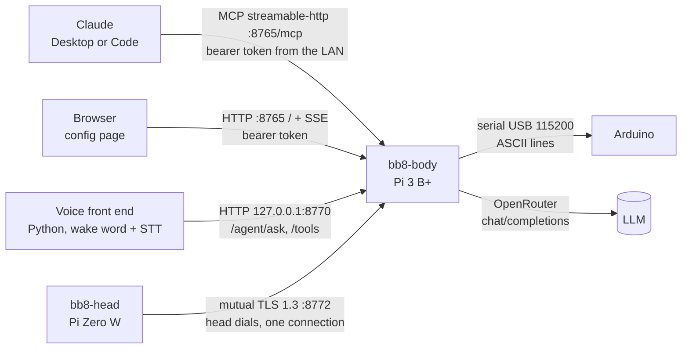

# BB-8 communication protocol

Version 0.4 · 2026-10-15.
- **0.4** moves the services to Go: `bb8-body` and `bb8-head`. The head is reached over a mutual-TLS link instead of HTTP :8080. It also adds the config API and the agent API, and the API, results and floor plan are now in English.
- **0.3** · 2026-10-15: added `/oido` and `/mapa`.
- **0.2** · 2026-10-09: added `P`, the `bateria` and `imu` flags, and `ERR bateria`.

This page is the single source of truth. If something changes here, it also changes in:
- the firmware ([`partes/1-protoboard/arduino/bb8_firmware`](https://github.com/erickdsama/bb8/tree/main/partes/1-protoboard/arduino/bb8_firmware));
- the Go side ([`go/internal/protocol`](https://github.com/erickdsama/bb8/blob/main/go/internal/protocol/protocol.go), [`go/internal/link`](https://github.com/erickdsama/bb8/blob/main/go/internal/link/link.go));
- the simulated Arduino ([`simulador/dummy/arduino_sim.py`](https://github.com/erickdsama/bb8/blob/main/simulador/dummy/arduino_sim.py)).

## Who talks to whom



| Link | Transport | Who starts it |
| --- | --- | --- |
| Claude → body | MCP streamable-http on `/mcp`, port 8765. Clients from the LAN need `Authorization: Bearer <token>` | Claude |
| Browser → body | HTTP on port 8765 (`/`, `/api/*`) with the same token, and SSE for live changes | Browser |
| Voice, power manager → body | HTTP JSON on `127.0.0.1:8770`, loopback only | Client |
| Body → Arduino | Serial USB 115200 8N1, one line per command | Always the Pi |
| Head ↔ body | Mutual TLS 1.3 on port 8772, one persistent connection, framed JSON | The head |
| Body → OpenRouter | HTTPS, OpenAI-compatible `chat/completions` with `tools` | Body (agent) |

Rules that do not break:

- `bb8-body` is the **only** process that opens the serial port.
- The Arduino never speaks unprompted: each line it sends answers a line from the Pi.
- The LLM never drives the motors directly. Every order goes through `bb8-body`, which clamps it and arbitrates with the gamepad.
- The head opens **no** ports. Only the body, with a cert from the BB-8 CA, can reach it.
- In the dummy, the serial port is `socket://127.0.0.1:5555`. `bb8-head --sim` forwards to the Python simulated head on `http://127.0.0.1:8080`.

## 1. Serial: Pi → Arduino

115200 baud, 8N1, ASCII.
- Each command is one line ending in `\n` (`\r\n` is accepted), at most 63 characters, with tokens separated by one space.
- The Arduino answers **exactly one line** per command: `OK [data]` or `ERR <reason>`.
- The Pi waits for the reply (200 ms timeout) before sending the next one.

| Command | Arguments | OK reply | What it does |
| --- | --- | --- | --- |
| `M <left> <right>` | integers −255…255 | `OK` | Target speed of each wheel on the PWM scale. The encoder PID and the ramp (at most 30 per 10 ms cycle) chase it. Feeds the watchdog. |
| `S` | — | `OK` | Immediate stop with brake, no ramp. Always accepted, even asleep. |
| `H <deg>` | integer −90…90 | `OK` | Angle of the post (head). 0 = forward, + right. With a positional MG996R: servo = 90 + deg. |
| `D <mm>` | integer 0…4000 | `OK` | Latest distance from the head ToF, forwarded by the Pi. 0 = no reading. Valid for 300 ms. |
| `?` | — | `OK V=… T=… Y=… E=…,… H=… D=… F=…` | Status (see below). |
| `Z` | — | `OK` | Sleep: brake, motors without PWM, servo `detach()`. Rejects `M` and `H`. |
| `W` | — | `OK` | Wake: servo `attach()`, then back to the last position slowly. |
| `I` | — | `OK BB8 fw=<version>` | Identification. The dummy answers `fw=sim-0.1`. |
| `P <s>` | integer 0, 5…120 | `OK` | Deep sleep (part 6). The Arduino brakes, cuts the Pi's power (A3) after `s` seconds and sleeps. When the IMU detects movement it wakes and powers the Pi again. The Pi sends it right before `shutdown -h`. `P 0` cancels a pending countdown. |

### Status line `?`

```
OK V=11.62 T=3.1 Y=-12.4 E=1420,1398 H=0 D=1830 F=-
```

| Key | Unit | Meaning |
| --- | --- | --- |
| `V` | volts | Battery. `0.00` = not measured (no divider on A0) |
| `T` | degrees | Absolute tilt from the MPU6050 (max of pitch and roll) |
| `Y` | degrees | Heading integrated from the gyro, + right. Not wrapped: it can pass 360 |
| `E` | ticks | Left,right encoder counts, signed, accumulated since boot |
| `H` | degrees | Current post angle |
| `D` | mm | Last ToF distance received with `D` (0 if it expired) |
| `F` | list | Active flags, comma-separated, or `-`. Flags: `obstacle`, `tilt`, `watchdog`, `sleep`, `bateria` (below 10.5 V for 5 s), `imu` (the MPU6050 does not answer: no tilt brake and no heading) |

The Pi ignores keys it does not know, so fields can be added without breaking anything.

### Errors

| Reply | When |
| --- | --- |
| `ERR syntax` | Unknown command, missing arguments, or arguments that are not integers |
| `ERR range` | Argument out of range |
| `ERR obstacle` | `M` with net forward motion (`left + right > 0`) while `D` < 250 mm. Backing up and turning in place are accepted |
| `ERR tilt` | `M` while tilt is over 35°. Clears by itself below 25° |
| `ERR sleep` | `M` or `H` while asleep |
| `ERR bateria` | `M` with the battery under 9.9 V (3.3 V per cell). Only with the divider on A0 |

### Firmware reflexes (they do not wait for the Pi)

| Event | Reaction | Flag |
| --- | --- | --- |
| Tilt > 35° | Immediate brake, target set to 0 | `tilt` |
| Valid `D` < 250 mm while moving forward | Immediate brake, target set to 0 | `obstacle` |
| Wheel target ≠ 0 and no `M` for 500 ms | Brake, target set to 0 | `watchdog` (cleared by the next `M`) |

Only `M` feeds the watchdog. If the Pi's motion loop hangs, the `?` polling does not keep the motors alive. That is why `bb8-body` resends `M` every 100 ms while moving.

### Boot

Opening the port resets the Uno (~2 s). The Pi waits 2 s, flushes input, sends `I` and checks that the reply starts with `OK BB8`.

### Example session

```
Pi  → I            Ard → OK BB8 fw=0.1
Pi  → H 0          Ard → OK
Pi  → D 1830       Ard → OK
Pi  → M 70 70      Ard → OK
Pi  → ?            Ard → OK V=12.00 T=1.2 Y=0.3 E=310,305 H=0 D=1610 F=-
Pi  → D 240        Ard → OK          (the Arduino brakes by itself here)
Pi  → M 70 70      Ard → ERR obstacle
Pi  → M -60 -60    Ard → OK          (backing up is allowed)
Pi  → S            Ard → OK
```

### ToF

In parts 1–4 the VL53L0X lives on the Arduino's I2C bus (`USAR_TOF_LOCAL 1`). The firmware brakes on that reading, and `D` is optional: if both arrive, the local one wins.

When the sensor moves to the head:
- The head pushes `tof` over the link every 100 ms, and `bb8-body` forwards it as `D <mm>` every 100 ms.
- It forwards it only if the head looks forward (`|H| ≤ 15°`). Otherwise it sends `D 0`, because that distance is not the path ahead.
- A pushed reading is valid for 300 ms. If the link drops, `D` goes to 0 and the ToF brake stops acting; the watchdog and the IMU keep working.

### L298N pinout

One PWM pin (`EN`) and two direction pins (`IN`) per motor. Arduino Uno, one L298N for both motors, ENA/ENB jumpers removed:

| Pin | Function |
| --- | --- |
| D5 / D6 | ENA / ENB (PWM, Timer0), left / right motor |
| D7, D8 | IN1, IN2 (left motor) |
| D11, D12 | IN3, IN4 (right motor) |
| D2 / D3 | Encoder C1 left / right (INT0 / INT1) |
| D4 / D10 | Encoder C2 left / right |
| D9 | Post servo (the Servo library disables PWM on D9 and D10) |
| A4 / A5 | I2C: MPU6050 (0x68) and, in parts 1–4, VL53L0X (0x29) |
| A2 | MPU6050 INT (pin-change, to wake) |
| A3 | Pi power cut for deep sleep (part 6). High = Pi off, so an Arduino reset leaves it on |
| A0 | Battery voltage divider (`V` in `?`) |

The L298N drops ~2 V, so at 12 V the motor sees ~10 V: top speed ~0.9 m/s instead of 1.08 m/s. It has no sleep mode; in `Z` the firmware sets `EN` to 0.

## 2. bb8-body HTTP

### 2.1 Tools (MCP and local API)

The MCP server (`:8765/mcp`) and the agent see the same tool registry. Tools with an asterisk move the robot, and are refused for an unknown voice.

| Tool | Arguments | Returns |
| --- | --- | --- |
| `move`* | `meters` −2…2 | movement result |
| `turn`* | `degrees` −360…360, + right | movement result |
| `look_at`* | `degrees` −90…90 | `{"result":"done","degrees":30}` |
| `stop` | — | `{"result":"done"}`; cancels what is running |
| `take_photo` | — | JPEG image (MCP image content). Error `the head has no camera` |
| `set_eye_color` | `color` (name or `#RRGGBB`), `pattern` `steady`/`breathe`/`blink`/`off` | `{"result":"done"}` or `{"result":"error","reason":…}` |
| `say` | `text` (Spanish) and/or `sound` (an emotion) | `{"result":"done","seconds":1.5}` |
| `express` | `emotion` | `{"result":"done","emotion":"curious","eye":"cyan breathe"}` |
| `listen` | `wait_s` 0…10 | hearing (below) |
| `get_map` | — | floor plan (§ 4) |
| `set_position` | `x`, `y`, optional `heading_deg` | `{"result":"done","robot":{…}}` |
| `update_map` | `action` `add_furniture`/`move_furniture`/`remove_furniture`/`close_door`/`open_door`, `name`, `x`, `y`, `width_m`, `length_m`, `height_m` | `{"result":"done"}` |
| `get_pose` | — | pose (below) |
| `get_setting` / `set_setting` | `key`, `value` | Only fields marked `agent` in the schema. A safety limit returns `not writable by this source` |
| connector tools | e.g. `weather`, `calendar_today`, `calendar_next`, `calendar_add` | Present only while the connector is enabled |

Color names: `red, green, blue, white, orange, yellow, purple, cyan, off`. Brightness is capped at 0.3 (the ring draws ~1 A at full white).

Emotions: `happy, excited, greeting, curious, question, thinking, yes, no, alert, scared, sad, error, yawn, wake, laugh`. Each one has its beep and its eye color.

Movement result:

```json
{"result": "done", "meters": 0.98, "seconds": 2.1}
{"result": "blocked", "meters": 0.42, "distance_m": 0.24, "reason": "obstacle"}
{"result": "manual_override"}
{"result": "cancelled", "meters": 0.3}
{"result": "timeout", "meters": 1.7}
{"result": "error", "reason": "tilt"}
```

Movement orders are queued and run one at a time; `stop` skips the queue. The gamepad has priority: if it sent something within `motion.manual_hold_s` (1 s), `move`, `turn` and `look_at` return `manual_override` without moving.

Pose:

```json
{"x_m": 0.52, "y_m": -0.10, "heading_deg": 12.4, "tilt_deg": 1.2, "battery_v": 11.62,
 "head_deg": 0, "tof_m": 1.83, "flags": [], "control": "llm", "asleep": false,
 "arduino": "OK BB8 fw=0.1", "status_age_s": 0.03,
 "head": {"connected": true, "backend": "real", "camera": true, "config_rev": 7}}
```

`control` is `llm`, `manual` or `idle`.

Hearing (`listen`, `GET /hearing`):

```json
{"heard": true, "text": "BB-8, ven", "level_db": 58.2, "ago_s": 1.4,
 "angle_deg": 35.0, "turned_since_deg": 20.0, "candidates_deg": [15.0, 125.0]}
```

The ReSpeaker 2-Mic has two capsules, left and right. It measures the sine of the angle, so it cannot tell front from back (35° and 145° sound the same). `candidates_deg` gives both possible headings relative to the **current** front (+ right), with the turn since the sound (`turned_since_deg`) already subtracted. Nothing heard: `{"heard": false}`.

### 2.2 Local API (`127.0.0.1:8770`, loopback only)

| Method and path | Body | Reply |
| --- | --- | --- |
| `POST /tools/{name}` | the tool's JSON arguments. Header `X-Speaker-Known: false` marks an unknown voice | the tool result. 403 if a moving tool is called by an unknown voice |
| `GET /tools` | — | tool names |
| `POST /manual` | `{"left": 120, "right": 120}` | Gamepad bridge. Resend every ≤ 200 ms or the watchdog stops |
| `GET /pose` | — | pose |
| `POST /hearing` | `{"text": "BB-8, ven", "angle_deg": 35, "level_db": 58}` | `{"result":"done"}`. `angle_deg` −90…90 or `null` |
| `GET /hearing?wait_s=3` | — | hearing; waits up to `wait_s` (≤ 10) for something new |
| `POST /sleep`, `POST /wake` | — | `{"result":"done"}` |
| `POST /poweroff` | `{"seconds": 15}` (5…120) | `{"result":"done","cut_in_s":15}`. Sends `P`; the caller runs `shutdown -h` right away |
| `POST /head/rest` | `{"active": false}` | Light sleep of the head: eye at a faint breathing, camera unused. `true` reverts it |
| `GET /head/photo?width=640` | — | `image/jpeg`, 503 without a camera |
| `GET /head` | — | head state: `connected`, `backend`, `camera`, `config_rev`… |
| `GET /agent` | — | `{"model":…, "ready": true}` |
| `POST /agent/ask` | `{"text": "[Speaker: Erick] da una vuelta", "speaker_known": true}` | `{"reply":"…","tools_used":["turn"],"steps":2}` |

### 2.3 Config and agent API (`:8765`, token from the LAN)

| Method and path | Body | Reply |
| --- | --- | --- |
| `GET /` | — | config page (HTML) |
| `GET /api/config` | — | `{"rev": 7, "values": {"motion.pwm_cruise": 140, "agent.api_key": "set", …}, "live": {…}}`. Secrets show as `"set"` or `""` |
| `GET /api/config/schema` | — | fields: `key`, `label`, `type` (`number`, `string`, `bool`, `enum`, `secret`), `default`, `min`, `max`, `options`, `agent`, `restart` |
| `PATCH /api/config` | `{"baseRev": 7, "values": {"head.volume": 0.5}}` | 200 with the new config. **409** with the latest config if `baseRev` is stale. 400 on validation errors (the whole patch is rejected) |
| `GET /api/config/events` | — | SSE. `hello` with the current rev, then one `change` event per applied write from **any** source (`web`, `agent`, `system`): `{"rev": 8, "source": "agent", "at": "…", "values": {"head.volume": 0.35}}` |
| `GET /api/config/audit` | — | the last 50 changes |
| `GET /api/connectors` | — | `[{"id": "weather", "state": "ok"}, {"id": "calendar", "state": "needs_auth", "detail": "…"}]` |
| `GET /api/connectors/calendar/auth` | — | Starts Google OAuth. The callback stores the refresh token as a secret |
| `GET /api/agent`, `POST /api/agent/ask` | as in § 2.2 | the web chat box |

Config storage:
- `--data` (`/var/lib/bb8` on the Pi) holds `config.json` (`{"rev", "values"}`) and `secrets.json` (mode 0600). Writes are atomic.
- Who may write what:
  - `web` and `system` may write every field;
  - `agent` may write only fields with `agent: true` (`head.volume`, `head.eye_brightness`, `voice.speed`, `home.city`, `home.owner`);
  - motion limits are also clamped in code (PWM ≤ 160, move ≤ 3 m) and in the firmware.

## 3. Head link (mutual TLS 1.3, port 8772)

**Pairing.** `bb8-body pair --dir /etc/bb8/pki` creates a private Ed25519 CA and two certs:
- `bb8-body` for the server, with optional extra host SANs;
- `bb8-head` for the client.

The head gets `ca.crt`, `bb8-head.crt` and `bb8-head.key`. Each side only accepts a peer cert signed by that CA **with the expected name**. A cert from another CA, or a plain TCP connection, is closed during the handshake.

**Connection.** The head dials `BB8_BODY_ADDR` (default `bb8.local:8772`) and verifies the body by the name `bb8-body`, so the IP can change. It reconnects with backoff from 0.5 s up to 5 s. A new head connection replaces the old one.

**Framing.** Each frame is `[u32 big-endian length][JSON]`, with a maximum of 8 MiB. The JSON message is:

```json
{"id": 12, "type": "photo", "reply": false, "body": {"width": 640}, "err": "", "bin": false}
```

- `id` ≠ 0 and `reply: false`: a request. The answer carries the same `id` with `reply: true`, plus `err` if it failed.
- `id` = 0: an event, with no reply.
- `bin: true`: the next frame is raw bytes (the JPEG of a photo).

| Direction | Type | Body | Reply / meaning |
| --- | --- | --- | --- |
| body → head | `photo` | `{"width": 640}` | `{"ok":true,"bytes":N}` + JPEG frame. `err: "no camera"` without a camera |
| body → head | `eye` | `{"rgb":[0,220,255],"pattern":"breathe","brightness":0.3}` | `{"ok":true}` |
| body → head | `say` | `{"text":"hola","sound":"happy"}` | `{"ok":true,"seconds":1.2}` when done |
| body → head | `rest` | `{"active": false}` | `{"ok":true}` |
| body → head | `config` (event) | `{"rev": 8, "values": {"eye_brightness": 0.3, "volume": 0.7}}` | The head applies it and answers with the `config_ack` event. The body sends it on every connect and on every change under `head.*` |
| head → body | `tof` (event) | `{"mm": 812}` | every 100 ms while there is a sensor |
| head → body | `sound_dir` (event) | `{"angle_deg": 35, "level_db": 58, "text": ""}` | ReSpeaker direction; lands in `listen` |
| head → body | `state` (event) | `{"backend":"real","camera":true,"eye":true,"tof":false,"config_rev":7}` | once per connection |
| head → body | `config_ack` (event) | `{"rev": 8}` | shown as `head.config_rev` |
| both | `heartbeat` (event) | — | every 1 s. A peer silent for 2.5 s is dropped. On drop the body reports `head: disconnected` and the ToF reading expires (`D 0`) |

Head hardware (Pi Zero W, armv6):
- **Camera:** `rpicam-jpeg` runs on demand.
- **Eye:** 16 NeoPixels on SPI0 MOSI (GPIO10).
- **Sound:** beeps synthesized in Go and played with `aplay`; speech with `espeak-ng`.
- **ToF:** VL53L0X on I2C1.
- **Voice direction:** the ReSpeaker DOA is an interface (`head.SoundDir`) until the HAT is installed.

## 4. Floor plan

`bb8-body --map` (env `BB8_MAP`) reads a JSON ([example](https://github.com/erickdsama/bb8/blob/main/partes/3-base-andando/mapas/ejemplo_casa.json)):

```json
{"name": "casa", "size_m": [8.0, 6.0],
 "start": {"x": 2.6, "y": 1.6, "heading_deg": 0},
 "rooms": [{"name": "sala", "x": [0.0, 4.5], "y": [0.0, 3.5]}],
 "doors": [{"between": ["sala", "cocina"], "x": 4.55, "y": 1.45, "width_m": 0.9}],
 "walls": [{"x": [4.5, 4.6], "y": [0.0, 1.0]}],
 "furniture": [{"name": "sofa", "x": [0.4, 2.6], "y": [0.05, 0.9], "height_m": 0.85}]}
```

**Axes.**
- x points east (right of the drawing) and y north (up), in meters from the south-west corner.
- `heading_deg` is **clockwise from east** (0 east, 90 south, −90 north), with the same sign as `turn`.

**Pose on the plan.**
- `start` is where the robot boots. The odometry (x forward, y right of boot) maps onto the plan from there.
- `set_position` moves that anchor.
- The pose is saved every 2 s to `--map-state`. After a restart the robot starts from the saved pose, marked uncertain.
- If the plan JSON breaks, the last good version stays in use and the reply carries `warning`.

`get_map` reply:

```json
{"plan": "casa", "size_m": [8.0, 6.0],
 "robot": {"x": 2.6, "y": 1.6, "heading_deg": 0.0, "room": "sala"},
 "position": {"uncertain": false, "traveled_since_fix_m": 0.0},
 "rooms": [{"name": "estudio", "x": [4.6, 8.0], "y": [3.6, 6.0], "distance_m": 4.89, "turn_deg": -41,
            "direct": false, "route": ["sala↔cocina", "cocina↔estudio"]}],
 "doors": [{"between": ["sala", "cocina"], "x": 4.55, "y": 1.45, "width_m": 0.9, "distance_m": 1.96,
            "turn_deg": 4, "direct": true}],
 "furniture": [{"name": "sofa", "x": [0.4, 2.6], "y": [0.05, 0.9], "distance_m": 1.4, "turn_deg": 151, "direct": true}],
 "sketch": ["#####…", "#mm..→..#…"]}
```

- `turn_deg` is what `turn` would need to face the center of each thing.
- `direct` says whether the straight line is free of walls and closed doors. Furniture does not count.
- `route` lists the open doors to cross, or `"no path through open doors"`.
- In a doorway, `room` is `null` and `robot.at_door` says which door.
- `position.uncertain` is `true` (with a `reason`) in three cases, and stays so until the next `set_position`:
  - after booting from the saved pose;
  - after a tilt;
  - when the IMU fails.
- `sketch` is north up, one character per 25 cm: `#` wall, `m` furniture, `.` floor, `=` closed door, and an arrow for the robot.
- `update_map` rewrites the JSON and keeps the previous version as `.bak`.

## 5. Dummy only (Python, `:8080`)

| Path | Purpose |
| --- | --- |
| `POST /sim/empujar` | `{"grados": 40}`: someone tilts it for 1 s |
| `GET /sim/mundo` | Real state of the simulated robot |
| `POST /sim/hablar`, `POST /sim/mover` | A person speaks (it reaches `/hearing`), or move the person |
| `GET /sim` | 2D viewer |
| `GET /foto`, `/tof`, `/estado`, `POST /ojo`, `/hablar`, `/reposo` | Simulated head, used only by `bb8-head --sim` |
